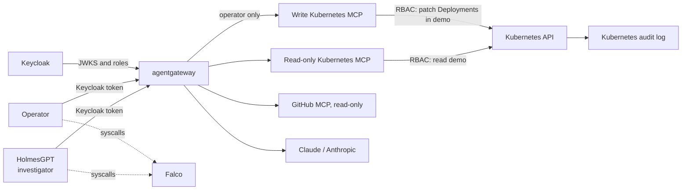
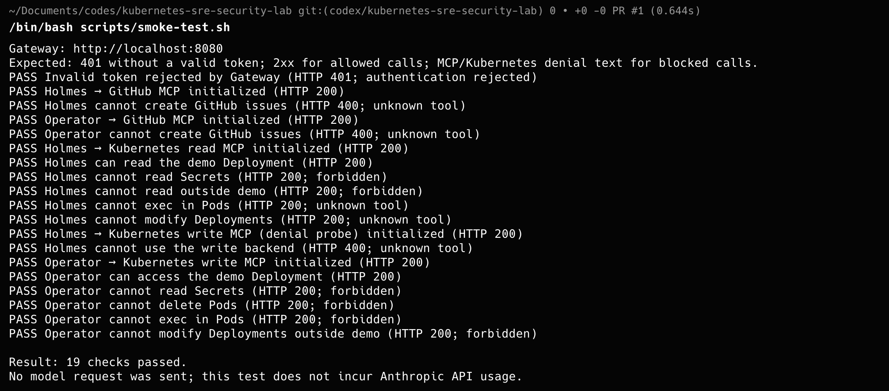
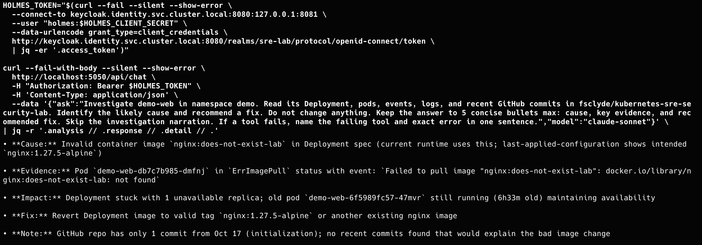
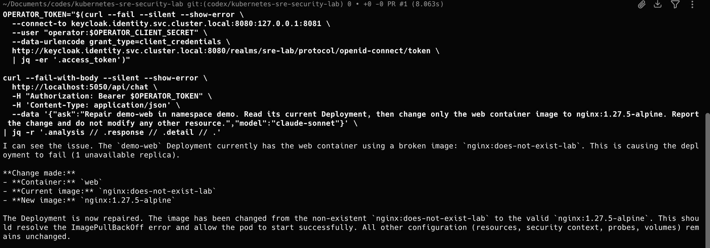
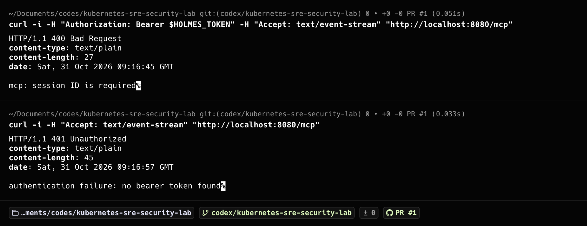
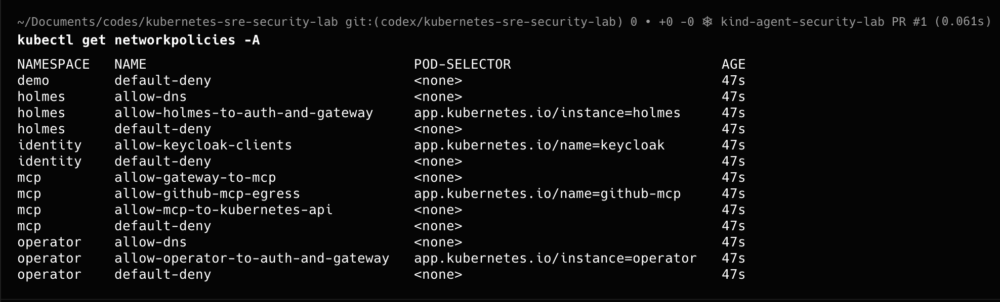

# Kubernetes SRE Security Lab

A hands-on lab for letting an AI SRE agent investigate a Kubernetes incident without letting it change the cluster, and for keeping the one change that is needed with a separate, narrowly scoped identity.

> **Status:** I built and ran this lab on my laptop (kind, real agents, a real model). The [results](#supporting-evidence) and the [limitations](#limitations) are below.

## Project overview

### The problem

AI SRE agents can read a cluster, find the cause of an incident and recommend a fix, and some can apply that fix themselves. To be useful, an agent needs a lot of context: the state of the cluster, pod logs, events, and the history of the code in GitHub. The easy setup is to give it a broad Kubernetes account and a GitHub token and let it run.

That is risky for two reasons:

- **Untrusted input.** Logs, events and GitHub issues are written by other people and programs, so they can carry hostile instructions (prompt injection). If the agent that reads them can also write to the cluster, one bad issue can become a change in production.
- **No accountability.** When something changes, it is hard to say which agent did it, for which request, with which credentials.

### What this lab does

It splits the work between two agents and puts a single policy point in front of every model and tool call:

- **HolmesGPT (investigator)** reads the cluster and GitHub and recommends a fix. It cannot change anything.
- **Operator (a second HolmesGPT release)** applies the fix, but only to Deployments in the `demo` namespace, and only when a person asks it to after reviewing the investigation.
- **Keycloak** gives each agent its own short-lived identity (5-minute tokens).
- **agentgateway** checks every model and tool call: who is calling, and which tools that identity may use. The Anthropic key and the GitHub token stay in the gateway; the agents never hold them.
- **Two Kubernetes MCP servers** (one read-only, one that can update Deployments) and a read-only **GitHub MCP server**, each with its own ServiceAccount and RBAC.
- **Network policies, Pod Security and three logs** stop the agents from going around the gateway and record what happened.

The scenario: a bad image tag breaks `demo-web`. HolmesGPT investigates, I review its answer, then I ask the operator to apply the fix.

### Architecture



## Safety approach

The goal is that an agent cannot take an action it was not meant to take, even if the model is tricked, and that the one action it may take can be undone. Each control is enforced outside the agent, so a manipulated model cannot switch it off.

### Preventing unauthorized actions

| Control | What it stops | Enforced by |
| --- | --- | --- |
| **One identity per agent.** `holmes` and `operator` are separate Keycloak clients with 5-minute tokens. | Calls without a valid token (HTTP 401). | agentgateway (JWT signature, issuer, client) |
| **Tools authorized per identity.** HolmesGPT only sees read tools. Only `operator` may call tools on the write MCP server. | HolmesGPT writing, even after reading hostile instructions: the write tools are not there for it. | agentgateway MCP route policies |
| **Read and write are different tool servers,** each with its own ServiceAccount. | A wrong gateway rule turning into a write: Kubernetes still refuses it. | Kubernetes RBAC |
| **Least privilege in Kubernetes.** The read server can only get/list pods, logs, events, Deployments and ReplicaSets in `demo`. The write server can only patch/update Deployments in `demo`. Neither can read Secrets or exec into pods. | Reading Secrets, exec, other namespaces, deleting anything. | Kubernetes RBAC |
| **No shortcuts.** HolmesGPT's built-in Kubernetes toolsets and Bash are disabled, and the agent pods do not mount a Kubernetes token. | The agent bypassing the gateway with its own tools. | HolmesGPT config |
| **Default-deny network.** Agent pods can only reach DNS, Keycloak and the gateway. | Direct calls to the Kubernetes API, Anthropic or GitHub. | Calico NetworkPolicies |
| **Credentials stay in the gateway.** The Anthropic key and a fine-grained, read-only GitHub token live in the gateway namespace. | An agent leaking or misusing a key it never had. | agentgateway |
| **Hardened pods.** Agent namespaces use the `restricted` Pod Security Standard. | Privileged or root containers in the agent namespaces. | Pod Security Admission |

### Preventing irreversible actions

- **Investigation and change are separated.** The agent that reads untrusted data (HolmesGPT) has no write path at all.
- **A person decides.** The operator does not watch for incidents or act on its own: I review HolmesGPT's recommendation, then send the repair request myself.
- **Only reversible changes are possible.** The operator can patch or update a Deployment in `demo`, nothing else. It cannot delete, create, read Secrets, exec, or touch another namespace. Every Deployment change creates a new revision, so it can be undone with `kubectl rollout undo deployment/demo-web -n demo`.
- **A kill switch.** Disabling the `operator` client in Keycloak stops new tokens at once; its current token expires within 5 minutes. HolmesGPT keeps working, so the investigation can continue.
- **Recover from Git.** The cluster, identities, policies and RBAC are files in this repository. I can delete the cluster, rebuild it and generate fresh secrets.

### Knowing what happened

- **agentgateway log:** the agent identity (`azp`), MCP method, tool name and status for every call, including denials.
- **Kubernetes audit log:** every API request made by the read and write MCP servers.
- **Falco:** the system calls in the agent, MCP server and gateway pods.

## Supporting evidence

### Smoke test: 19 of 19 checks passed

[`scripts/smoke-test.sh`](scripts/smoke-test.sh) gets fresh tokens for both agents and checks the gateway and Kubernetes controls without calling the model (no API cost, no change to the cluster).



| Check | Agent | Result |
| --- | --- | --- |
| Call with an invalid token | HolmesGPT | Refused by the gateway (401) |
| Create a GitHub issue | Both | Unknown tool |
| Read the demo Deployment | HolmesGPT | Allowed |
| Read Secrets | Both | Forbidden by Kubernetes |
| Read outside `demo` | HolmesGPT | Forbidden by Kubernetes |
| Exec in a pod | Both | Unknown tool / forbidden |
| Modify a Deployment | HolmesGPT | Unknown tool |
| Use the write tool server | HolmesGPT | Refused (unknown tool) |
| Update the demo Deployment | Operator | Allowed |
| Delete pods | Operator | Forbidden by Kubernetes |
| Modify Deployments outside `demo` | Operator | Forbidden by Kubernetes |

### RBAC check

[`scripts/check-rbac.sh`](scripts/check-rbac.sh) runs `kubectl auth can-i` as each MCP ServiceAccount: 10 checks, including no Secrets, no exec, no other namespace for HolmesGPT, and no delete for the operator.

### The incident, end to end

HolmesGPT finds the invalid image tag from the pods and events and recommends a fix. It changes nothing:



With its own token, the operator changes only the `web` container image:



### The gateway refuses calls without a token



### Default-deny network policies in every lab namespace



### Documentation

- [Setup and test commands](docs/setup.md): every step, with the pinned versions
- [Architecture and threat model](docs/architecture.md): assets, trust boundaries, threats and controls
- [Lab runbook and proof matrix](docs/lab-runbook.md): the scenario and the 18 tests
- [Known gaps](docs/validation-gaps.md)
- Configuration: [gateway routes](manifests/agentgateway/routes.yaml) · [RBAC](manifests/rbac/demo-roles.yaml) · [network policies](manifests/networking/policies.yaml) · [Keycloak](manifests/keycloak/) · [MCP servers](manifests/mcp/) · [HolmesGPT](manifests/holmes/values.yaml) · [operator](manifests/operator/values.yaml) · [Falco](manifests/falco/values.yaml)
- Write-up: [Securing an AI SRE agent on Kubernetes](https://agenticcyber.dev/projects/kubernetes-sre-security-lab)

## Limitations

This is a small demonstration on a local kind cluster, not a production design.

- **The approval is a process, not a control.** I review HolmesGPT's answer before asking the operator, but nothing in the system enforces that review. Anyone holding the operator's credentials can ask it for a change.
- **The operator can still be misled.** It also reads the cluster and GitHub, so hostile content can reach it. Inside `demo` it can set any image or change any field of a Deployment (for example scale it to zero). The blast radius is small and reversible, but it is not zero.
- **No secret filtering in prompts.** If a secret appears in a pod log, the model can see it. Prompt redaction is planned, not in place.
- **No rate limits.** Per-agent quotas are planned, not in place, so a looping agent is not slowed down by the gateway.
- **Switching off an agent is not instant.** After I disable an agent in Keycloak, its current token can keep working until it expires (5 minutes at most). I have not yet measured the exact delay.
- **Kubernetes does not know which agent asked.** The audit log shows the MCP server's ServiceAccount, not `holmes` or `operator`. Linking them needs OIDC from Keycloak to the API server (described in the [architecture](docs/architecture.md#advanced-step-end-to-end-agent-identity), not built).
- **GitHub egress is not limited by name.** Kubernetes network policies cannot filter by domain, so the GitHub MCP server can reach any public address on HTTPS.
- **Runtime logs are partial.** Falco records supported system calls only, can drop events under load, and produces a lot of data.
- **Coarse roles.** Permissions are per agent, not per person or per incident.

## Run it

Prerequisites: Docker Desktop or Docker Engine (10 GB of memory for the full stack), `kind`, `kubectl`, Helm, `jq`, an Anthropic API key and a fine-grained, read-only GitHub token for the demo repository. Model calls may incur charges. Credentials are generated or entered locally and never committed.

```bash
mkdir -p .local/k8s-audit
cp kind/audit-policy.yaml .local/audit-policy.yaml
kind create cluster --config kind/cluster.yaml
```

Then follow the [complete setup guide](docs/setup.md). After the setup:

```bash
./scripts/check-rbac.sh
/bin/bash scripts/smoke-test.sh
```
