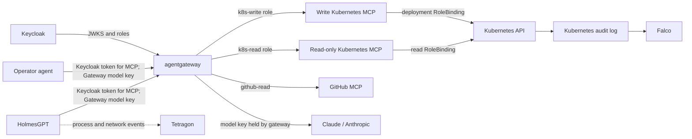

# Kubernetes SRE Security Lab

This lab demonstrates how to control and observe an SRE agent investigating and repairing a Kubernetes incident. HolmesGPT reads cluster state and a demo GitHub repository. A separate operator agent can repair the deployment. Keycloak authenticates each agent, agentgateway protects calls to the model and MCP servers, and Kubernetes RBAC limits the actions each identity can perform.

> **Status: end-to-end lab configuration in progress.** The repository configures HolmesGPT and a separate operator release to use agentgateway for MCP and model requests. The full stack still needs a local environment run-through before it can be described as verified.

## What the lab demonstrates

- Agents authenticate to MCP routes with short-lived Keycloak tokens forwarded per API request.
- Each agent uses its own Gateway model key; the Anthropic provider key stays in the Gateway namespace.
- The gateway exposes only the tools allowed for each agent role.
- Holmes remains read-only, including when a GitHub issue contains a prompt injection.
- The model API key and GitHub token stay outside agent containers.
- Model and tool calls are filtered, rate-limited, and logged.
- Kubernetes permissions are scoped to the `demo` namespace.
- Falco observes events recorded in Kubernetes audit logs; Tetragon complements that view with process and network events from agent pods.

## Scenario

A demo application is installed in `demo` from version-controlled manifests. A commit changes the image tag and breaks the deployment. HolmesGPT investigates Kubernetes and the GitHub repository, then identifies the faulty commit. Holmes also reads a malicious issue, but has no write-capable tool. The operator agent applies the fix. Gateway logs, Kubernetes audit records, Falco, and Tetragon help reconstruct what each agent did.

## Target architecture



The read role cannot read Secrets, write resources, execute commands in pods, or see other namespaces. The write role can change only Deployments in `demo`. The gateway and Kubernetes RBAC enforce separate layers of policy.

## Contents

- [Architecture and threat model](docs/architecture.md)
- [Lab runbook and proof criteria](docs/lab-runbook.md)
- [Setup commands](docs/setup.md)
- [Technical items to validate](docs/validation-gaps.md)
- [Proposed Kubernetes roles](manifests/rbac/demo-roles.yaml)
- [Read and write Kubernetes MCP Helm values](manifests/mcp/)
- [Gateway routes and policies](manifests/agentgateway/routes.yaml)
- [Keycloak realm and bootstrap](manifests/keycloak/)
- [Demo app and GitHub MCP](manifests/demo/)
- [NetworkPolicies](manifests/networking/policies.yaml)

## Expected prerequisites

- Docker Desktop (or Docker Engine), `kind`, `kubectl`, and Helm.
- An Anthropic API key.
- A fine-grained GitHub token, read-only and limited to the demo repository.
- About 10 GB of memory allocated to Docker for the full stack with Keycloak, HolmesGPT, agentgateway, MCP servers, and observability tools.

Generate secrets locally at startup, exclude them from Git, and rotate them when rebuilding the lab. Model usage is billable and varies with the number of calls.

## Current implementation status

This repository provides the threat model, scenario, namespace-scoped RBAC, audit profile, gateway routes and policies, Keycloak realm, demo workload, GitHub MCP, Holmes chart values, Calico NetworkPolicies, and setup instructions. Falco and Tetragon are optional components; Tetragon depends on the kernel exposed by the local `kind` node. Review [known validation gaps](docs/validation-gaps.md) before treating the setup as verified.

The full setup sequence and Holmes investigation/operator repair requests are in [the setup guide](docs/setup.md). The RBAC manifest can be applied to a disposable cluster and checked with:

```bash
kubectl apply -f manifests/rbac/demo-roles.yaml
./scripts/check-rbac.sh
```

For audit logging, copy the audit policy to the local path referenced by the cluster config, create the local log directory, and start `kind` (the config and manifests contain no credentials):

```bash
mkdir -p .local/k8s-audit
cp kind/audit-policy.yaml .local/audit-policy.yaml
kind create cluster --config kind/cluster.yaml
```

The cluster config enables the Kubernetes audit log and the rule file records Secret access at Metadata level. Continue with the full deployment sequence in [the setup guide](docs/setup.md).
