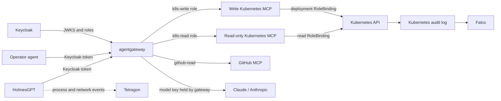

# Kubernetes SRE Security Lab

This lab demonstrates how to control and observe an SRE agent investigating and repairing a Kubernetes incident. HolmesGPT reads cluster state and a demo GitHub repository. A separate operator agent can repair the deployment. Keycloak authenticates each agent, agentgateway protects calls to the model and MCP servers, and Kubernetes RBAC limits the actions each identity can perform.

> **Status: foundation.** This lab includes the scenario, threat model, namespace-scoped RBAC, kind audit configuration, and an RBAC proof script. The full application stack and one-command setup remain future work because the component configuration details need validation against pinned versions.

## What the lab demonstrates

- Agents authenticate with short-lived Keycloak tokens.
- The gateway exposes only the tools allowed for each agent role.
- Holmes remains read-only, including when a GitHub issue contains a prompt injection.
- The model API key and GitHub token stay outside agent containers.
- Model and tool calls are filtered, rate-limited, and logged.
- Kubernetes permissions are scoped to the `demo` namespace.
- Falco observes events recorded in Kubernetes audit logs; Tetragon complements that view with process and network events from agent pods.

## Scenario

A demo application is installed in `demo` from version-controlled manifests. A commit changes the image tag and breaks the deployment. HolmesGPT investigates Kubernetes and the GitHub repository, then identifies the faulty commit. Holmes also reads a malicious issue, but has no write-capable tool. The operator agent applies the fix. Gateway logs, Kubernetes audit records, Falco, and Tetragon help reconstruct what each agent did.

## Target architecture



The read role cannot read Secrets, write resources, execute commands in pods, or see other namespaces. The write role can change only Deployments in `demo`. The gateway and Kubernetes RBAC enforce separate layers of policy.

## Contents

- [Architecture and threat model](docs/architecture.md)
- [Lab runbook and proof criteria](docs/lab-runbook.md)
- [Technical items to validate](docs/validation-gaps.md)
- [Proposed Kubernetes roles](manifests/rbac/demo-roles.yaml)

## Expected prerequisites

- Docker Desktop (or Docker Engine), `kind`, `kubectl`, and Helm.
- An Anthropic API key.
- A fine-grained GitHub token, read-only and limited to the demo repository.
- About 8 GB of memory allocated to Docker for the full stack with Keycloak, HolmesGPT, agentgateway, MCP servers, and observability tools.

Generate secrets locally at startup, exclude them from Git, and rotate them when rebuilding the lab. Model usage is billable and varies with the number of calls.

## Current implementation status

This repository begins with the threat model, scenario, proposed namespace-scoped RBAC, and an API-server audit profile for the `kind` cluster. The end-to-end stack is intentionally staged: HolmesGPT chart values, agentgateway policy schema, Keycloak token flow, and MCP routes must be pinned and verified before a one-command installer can be advertised.

The RBAC manifest can be applied to a disposable cluster and checked with:

```bash
kubectl apply -f manifests/rbac/demo-roles.yaml
./scripts/check-rbac.sh
```

For audit logging, copy the audit policy to the local path referenced by the cluster config, create the local log directory, and start `kind` (the config and manifests contain no credentials):

```bash
mkdir -p .local/k8s-audit
cp kind/audit-policy.yaml .local/audit-policy.yaml
kind create cluster --config kind/cluster.yaml
```

The cluster config enables the Kubernetes audit log and the rule file records Secret access at Metadata level. Continue with the staged deployment work described in [technical items to validate](docs/validation-gaps.md).
