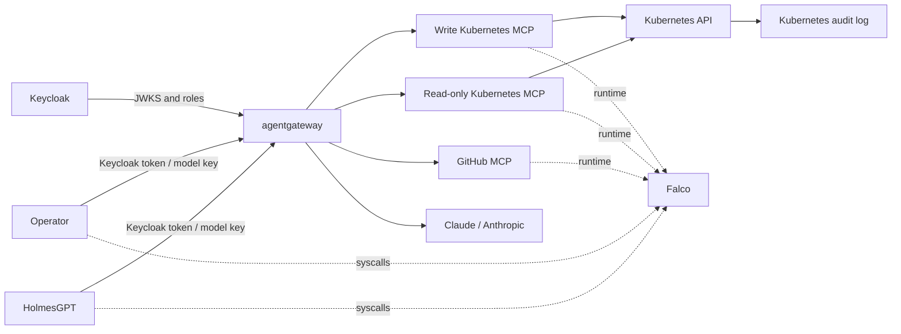

# Kubernetes SRE Security Lab

A hands-on lab for securing an AI SRE workflow on Kubernetes. HolmesGPT investigates an incident using read-only Kubernetes and GitHub tools. A separately authenticated operator can repair the demo application.

> **Status:** Configuration is in progress and still needs a complete local run-through.

## Security controls

- **Keycloak + agentgateway:** authenticate Holmes and operator separately; authorize MCP and model requests.
- **Tool and Kubernetes RBAC:** keep Holmes read-only and limit operator changes to Deployments in `demo`.
- **Secret handling:** keep the Anthropic key and GitHub token outside agent containers.
- **NetworkPolicy + Pod Security:** restrict workload egress and run agent pods with the restricted profile.
- **Activity trail:** Falco records supported syscalls in agent, MCP, and Gateway pods; Gateway logs show model/MCP requests; Kubernetes audit logs show API actions.

## Scenario

A bad image tag makes `demo-web` unavailable. Holmes investigates the Deployment, pods, events, logs, and GitHub history, then recommends a fix. The learner reviews the recommendation and asks the operator to apply it. Holmes cannot make changes.

## Architecture



Holmes cannot read Secrets, write resources, execute commands in pods, or access other namespaces. The operator can update Deployments only in `demo`.

## Start here

- [Setup and test commands](docs/setup.md)
- [Architecture and threat model](docs/architecture.md)
- [Lab runbook and proof criteria](docs/lab-runbook.md)
- [Known validation gaps](docs/validation-gaps.md)

Other configuration: [Falco runtime rules](manifests/falco/values.yaml) · [RBAC](manifests/rbac/demo-roles.yaml) · [Gateway](manifests/agentgateway/routes.yaml) · [Keycloak](manifests/keycloak/) · [MCP servers](manifests/mcp/) · [Demo and GitHub MCP](manifests/demo/) · [NetworkPolicies](manifests/networking/policies.yaml)

## Prerequisites

- Docker Desktop or Docker Engine, `kind`, `kubectl`, Helm, `jq`, and a shell.
- Anthropic API key and a fine-grained, read-only GitHub token for the demo repository.
- At least 10 GB of memory allocated to Docker for the full stack.

Model calls may incur charges. Generate credentials locally, keep them out of Git, and rotate them when rebuilding the lab.

## Quick checks

Apply the RBAC manifest and verify permissions:

```bash
kubectl apply -f manifests/rbac/demo-roles.yaml
./scripts/check-rbac.sh
```

For Kubernetes audit logging, create the local paths before creating the kind cluster:

```bash
mkdir -p .local/k8s-audit
cp kind/audit-policy.yaml .local/audit-policy.yaml
kind create cluster --config kind/cluster.yaml
```

Continue with the [complete setup guide](docs/setup.md).