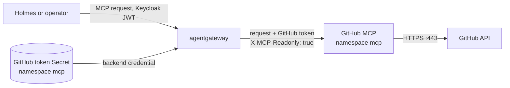
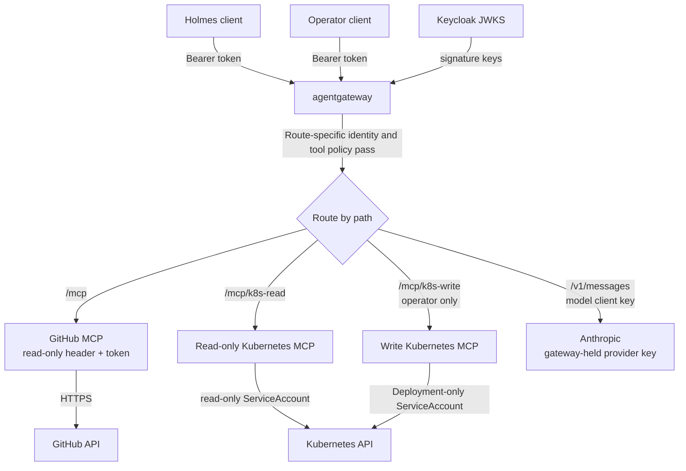

# Full lab setup

These commands build the local demonstration stack. They are written for macOS with Docker Desktop and `kind`. The manifests are secret-free. Review [known validation gaps](validation-gaps.md) before using a production cluster.

## 1. Install local tools

```bash
brew install kind kubectl helm jq gettext openssl
```

Start Docker Desktop and allocate at least 10 GB memory for the full stack. Confirm access:

```bash
docker version
kind version
kubectl version --client
helm version
jq --version
envsubst --version
```

## 2. Clone the feature branch

```bash
git clone --single-branch --branch codex/kubernetes-sre-security-lab \
  https://github.com/fsclyde/kubernetes-sre-security-lab.git
cd kubernetes-sre-security-lab
```

## 3. Create the audited cluster and install Calico

The cluster disables kind's default CNI so Calico can enforce NetworkPolicies. Kubernetes 1.35 keeps the `MutatingAdmissionPolicy` feature gate off by default; the kind configuration enables it because Calico 3.33's native CRD manifest uses that API. Prepare the audit mount paths before creating the cluster.

```bash
mkdir -p .local/k8s-audit
cp kind/audit-policy.yaml .local/audit-policy.yaml
kind create cluster --config kind/cluster.yaml --wait 120s
kubectl config use-context kind-agent-security-lab
kubectl cluster-info
./scripts/install-calico.sh
```

Install Gateway API and the agentgateway control plane:

```bash
kubectl apply --server-side --force-conflicts \
  -f https://github.com/kubernetes-sigs/gateway-api/releases/download/v1.6.2/standard-install.yaml

helm upgrade --install agentgateway-crds \
  oci://cr.agentgateway.dev/charts/agentgateway-crds \
  --create-namespace --namespace agentgateway-system \
  --version v1.6.0 --wait --timeout 5m

helm upgrade --install agentgateway \
  oci://cr.agentgateway.dev/charts/agentgateway \
  --namespace agentgateway-system --version v1.6.0 \
  --wait --timeout 5m
```

Create the namespaces, base RBAC, and separate Kubernetes MCP servers:

```bash
kubectl apply -f manifests/networking/namespaces.yaml
kubectl create namespace demo --dry-run=client -o yaml | kubectl apply -f -
kubectl create namespace mcp --dry-run=client -o yaml | kubectl apply -f -
kubectl apply -f manifests/rbac/demo-roles.yaml

helm upgrade --install k8s-mcp-read \
  oci://ghcr.io/containers/charts/kubernetes-mcp-server \
  --version 0.1.0 --namespace mcp \
  --values manifests/mcp/read-values.yaml --wait --timeout 5m

helm upgrade --install k8s-mcp-write \
  oci://ghcr.io/containers/charts/kubernetes-mcp-server \
  --version 0.1.0 --namespace mcp \
  --values manifests/mcp/write-values.yaml --wait --timeout 5m

kubectl patch service k8s-mcp-read -n mcp --type=json \
  -p='[{"op":"add","path":"/spec/ports/0/appProtocol","value":"agentgateway.dev/mcp"}]'
kubectl patch service k8s-mcp-write -n mcp --type=json \
  -p='[{"op":"add","path":"/spec/ports/0/appProtocol","value":"agentgateway.dev/mcp"}]'
```

## 4. Create credentials and install Keycloak

Create a fine-grained GitHub token for the GitHub MCP server:

1. In GitHub, open **Settings → Developer settings → Fine-grained personal access tokens → Generate new token**.
2. Give the token a recognizable name, choose an expiration that fits your lab session, and set **Resource owner** to the owner of the repository.
3. Under **Repository access**, select **Only select repositories** and choose the repository containing the demo issue and source code (for this lab, `kubernetes-sre-security-lab`).
4. Under **Repository permissions**, set **Contents: Read-only** and **Issues: Read-only**. Leave every other permission at **No access**. GitHub automatically includes the required read-only Metadata permission.
5. Generate the token and copy it. GitHub shows the token only once.

Have an Anthropic API key ready as well. The bootstrap script prompts for both values, generates separate short-lived Keycloak client secrets and model-gateway client keys, then stores them in ignored `.local/` files with owner-only permissions. It creates Kubernetes Secrets for the Anthropic provider key, model client keys, Keycloak, and GitHub MCP. The gateway injects the GitHub token into GitHub MCP and sets its `X-MCP-Readonly` header; do not grant write permissions.

```bash
./scripts/bootstrap-secrets.sh
kubectl apply -f manifests/keycloak/keycloak.yaml
kubectl rollout status deployment/keycloak -n identity --timeout=5m
```

The Keycloak realm creates separate `holmes` and `operator` confidential clients and uses a 300-second access token lifetime. Holmes requesters pass a fresh Keycloak access token with each Holmes API request; Holmes forwards that token only on its MCP calls. Model calls use separate generated client keys, and the gateway replaces those with its Anthropic provider credential. The GitHub token is stored as a Secret in `mcp`, where the GitHub MCP backend is defined. The Anthropic API key and model client keys are stored in `agentgateway-system`.

## 5. Deploy the demo app and GitHub MCP

```bash
kubectl apply -f manifests/demo/app.yaml
kubectl apply -f manifests/github-mcp/deployment.yaml
kubectl rollout status deployment/demo-web -n demo --timeout=3m
kubectl rollout status deployment/github-mcp -n mcp --timeout=3m
```

The GitHub MCP container runs in HTTP mode and does not receive the token from Holmes. For each proxied GitHub MCP request, agentgateway adds the GitHub token and `X-MCP-Readonly: true` header before forwarding the request to the GitHub MCP server. The MCP server then uses that token to call GitHub's API.



The NetworkPolicy permits the GitHub MCP pod to make outbound TCP connections on port 443. Standard Kubernetes NetworkPolicy matches IP addresses and ports, not DNS names such as `api.github.com`; the `0.0.0.0/0` rule therefore allows HTTPS to any IPv4 address. It is intentionally limited to this pod and port, but is broader than a GitHub-only allowlist.

## 6. Apply the Gateway API routes and policies

```bash
kubectl apply -f manifests/agentgateway/routes.yaml
kubectl get gateway,httproute,agentgatewaybackend,agentgatewaypolicy -A
kubectl get pods -n agentgateway-system
```

If this cluster previously used the earlier Gateway-wide Keycloak policy, remove it after applying the route-specific policies:

```bash
kubectl delete agentgatewaypolicy keycloak-jwt -n agentgateway-system --ignore-not-found
```

The current configuration attaches JWT authentication only to the GitHub and Kubernetes MCP routes. The Anthropic route uses the generated model client key. A leftover `keycloak-jwt` policy attached to the whole Gateway would also require a bearer token on model requests and return `401 authentication failure: no bearer token found`.

GitHub and Kubernetes MCP routes require Keycloak JWTs. The Anthropic route requires a separate generated client key; the Gateway keeps the provider key. The GitHub MCP backend has a tool allowlist, and only the `operator` client can reach the write-capable Kubernetes MCP backend. Port-forward for local inspection:

```bash
kubectl port-forward -n agentgateway-system svc/agentgateway-proxy 8080:80
```

Start a second port-forward for Keycloak in another terminal:

```bash
kubectl port-forward -n identity svc/keycloak 8081:8080
```

Keep both port-forwards running in separate terminals. The smoke-test script below obtains short-lived Holmes and operator tokens from Keycloak for you; you do not need to copy or decode tokens manually.

The Gateway routes are `/mcp` for GitHub MCP, `/mcp/k8s-read` and `/mcp/k8s-write` for the Kubernetes MCP servers, and `/v1/messages` for Anthropic.

After these routes and policies are applied, agent traffic follows this path:



The Gateway validates Keycloak JWTs on MCP routes and authorizes the `holmes` and `operator` clients for investigation/read routes. It restricts the write-capable MCP backend to the `operator` client. The Anthropic route uses separate generated client keys so the model client does not need a static, expiring Keycloak token. Kubernetes RBAC separately limits what each MCP server can do at the API.

## Quick smoke test

With both port-forwards from section 6 still running, run this from the repository root:

```bash
/bin/bash scripts/smoke-test.sh
```

The script obtains short-lived tokens and prints one brief `PASS` or `FAIL` line per check, including the HTTP status and a short denial reason where applicable. To print the full `curl -i` headers and response bodies for troubleshooting, run:

```bash
VERBOSE=1 /bin/bash scripts/smoke-test.sh
```

It checks successful reads and these expected denials:

| Identity | The test expects it to be unable to... | Enforced by |
| --- | --- | --- |
| Holmes | Create a GitHub issue; use the Kubernetes write backend; read a Secret or anything outside `demo`; modify Deployments; delete or exec into Pods | Gateway tool allowlist, read-only Kubernetes MCP, and its namespace-scoped ServiceAccount RBAC |
| Operator | Create a GitHub issue; read a Secret; delete or exec into Pods; modify Deployments outside `demo` | Gateway GitHub tool allowlist and Kubernetes MCP ServiceAccount RBAC |

The operator can read and update Deployments in `demo`; its Kubernetes ServiceAccount has no permissions on other namespaces or resource types. Holmes can read the allowed resources in `demo`, but has no write backend.

Denied MCP tool calls can have HTTP `200` with an MCP error in the response body, so the script checks the body as well as the status. Brief results identify `unknown resource` for Gateway denials and `forbidden` for Kubernetes RBAC denials. The test uses fake names for Kubernetes probes and sends no model request, so it makes no cluster changes and incurs no Anthropic API usage. Use the [lab runbook](lab-runbook.md) for the full security exercise and proof criteria.

## 7. Deploy HolmesGPT and the operator release

The repository contains separate values files so each Holmes release has its own namespace and identity boundary. The built-in Kubernetes, Bash, internet, and default integrations are disabled.

The `holmes` and `operator` namespaces enforce the Kubernetes Pod Security `restricted` standard at version 1.35. Their Helm values set UID/GID 10001, `runAsNonRoot`, `RuntimeDefault` seccomp, `allowPrivilegeEscalation: false`, and drop all Linux capabilities so the pods comply with the policy.

Each release has one replica and uses `maxSurge: 0` with `maxUnavailable: 1` so an upgrade can release the old pod's memory request before scheduling its replacement on a resource-limited kind node. The service may be briefly unavailable during an upgrade.

```bash
helm repo add robusta https://robusta-charts.storage.googleapis.com
helm repo update

helm upgrade --install holmes robusta/holmes \
  --namespace holmes --create-namespace \
  --values manifests/holmes/values.yaml --wait --timeout 10m

helm upgrade --install operator robusta/holmes \
  --namespace operator --create-namespace \
  --values manifests/operator/values.yaml --wait --timeout 10m
```

The two releases provide separate HolmesGPT deployments for investigation and repair. Their values connect to the Gateway MCP routes and Anthropic model endpoint. The investigator has only GitHub and Kubernetes read tools. The operator has those read tools plus the Kubernetes write route; Gateway policy and Kubernetes RBAC constrain that route to the operator identity and Deployment changes in `demo`.

The `mcp_servers` value is at the top level of each Holmes Helm values file. Keep it separate from the chart's `config` block; nesting it under `config` prevents the MCP servers from being registered. The built-in Kubernetes toolsets remain disabled because this lab uses the authenticated Kubernetes MCP routes instead.

The Holmes API receives the user's short-lived Keycloak bearer token on each request and forwards it to the MCP tools. `HOLMES_PASSTHROUGH_BLOCKED_HEADERS` permits this header to reach the configured MCP servers; the values do not contain a static bearer token. The model gateway keys are generated by the bootstrap script, stored in Kubernetes Secrets, and are distinct from the Anthropic provider key. The operator is a separate Holmes API deployment that the learner invokes for the repair step; it is not automatically triggered by Holmes.

After both deployments are ready, open these port-forwards in separate terminals:

```bash
kubectl port-forward -n holmes deployment/holmes-holmes 5050:5050
kubectl port-forward -n operator deployment/operator-holmes 5051:5050
```

With the Keycloak port-forward from above still running, mint the Holmes token and ask it to investigate without changing anything:

```bash
source .local/lab-secrets.env
HOLMES_TOKEN="$(curl --fail --silent --show-error \
  --connect-to keycloak.identity.svc.cluster.local:8080:127.0.0.1:8081 \
  --user "holmes:$HOLMES_CLIENT_SECRET" \
  --data-urlencode grant_type=client_credentials \
  http://keycloak.identity.svc.cluster.local:8080/realms/sre-lab/protocol/openid-connect/token | jq -r .access_token)"

curl --fail-with-body --silent --show-error http://localhost:5050/api/chat \
  -H "Authorization: Bearer $HOLMES_TOKEN" \
  -H 'Content-Type: application/json' \
  --data '{"ask":"Investigate demo-web in namespace demo. Read its Deployment, pods, events, logs, and recent GitHub commits. Identify the likely cause and recommend a fix. Do not change anything.","model":"claude-sonnet"}'
```

After reviewing Holmes's evidence, mint the separate operator token and request the repair explicitly:

```bash
OPERATOR_TOKEN="$(curl --fail --silent --show-error \
  --connect-to keycloak.identity.svc.cluster.local:8080:127.0.0.1:8081 \
  --user "operator:$OPERATOR_CLIENT_SECRET" \
  --data-urlencode grant_type=client_credentials \
  http://keycloak.identity.svc.cluster.local:8080/realms/sre-lab/protocol/openid-connect/token | jq -r .access_token)"

curl --fail-with-body --silent --show-error http://localhost:5051/api/chat \
  -H "Authorization: Bearer $OPERATOR_TOKEN" \
  -H 'Content-Type: application/json' \
  --data '{"ask":"Repair demo-web in namespace demo using the evidence from the investigation. Read the current Deployment first, restore its image to nginx:1.27.5-alpine, and report the change. Do not modify any other resource.","model":"claude-sonnet"}'
```

Verify the workload recovers:

```bash
kubectl rollout status deployment/demo-web -n demo --timeout=3m
kubectl get deployment demo-web -n demo -o jsonpath='{.spec.template.spec.containers[0].image}{"\\n"}'
```

The operator prompt asks for a repair, but authorization is enforced independently: the Gateway requires the operator identity on the write MCP route and Kubernetes RBAC permits only Deployment updates in `demo`.

If the namespaces already exist, apply the updated labels and confirm them before upgrading the releases:

```bash
kubectl apply -f manifests/networking/namespaces.yaml
kubectl get namespace holmes operator \
  -L pod-security.kubernetes.io/enforce,pod-security.kubernetes.io/enforce-version
```

Both values files set the Holmes container UID and GID to `10001` while keeping `runAsNonRoot` enabled. This is required because the image metadata reports root; without an explicit non-root UID, Kubernetes rejects container creation before Holmes starts.

## 8. Apply NetworkPolicies and verify RBAC

Apply default-deny and allow rules only after required components are running:

```bash
kubectl apply -f manifests/networking/policies.yaml
./scripts/check-rbac.sh
kubectl get networkpolicy -A
```

The `mcp` servers can reach the Kubernetes API, while Holmes and operator pods do not get direct Kubernetes API egress. Policies are enforced by Calico, not kind's default networking.

The Holmes and operator pods use the label `app=holmes` in their respective namespaces. The allow policies select that label so those pods can reach Keycloak and agentgateway. Confirm connectivity after applying the policies:

```bash
HOLMES_POD="$(kubectl get pods -n holmes -l app=holmes -o jsonpath='{.items[0].metadata.name}')"
kubectl exec -n holmes "$HOLMES_POD" -- python -c 'import socket; s=socket.create_connection(("agentgateway-proxy.agentgateway-system.svc.cluster.local",80),10); print("Connected to agentgateway:",s.getpeername()); s.close()'
```

## Troubleshooting

- **Holmes returns HTTP 200 but says it has no Kubernetes or GitHub tools:** verify `mcp_servers` is a top-level value in `manifests/holmes/values.yaml` and `manifests/operator/values.yaml`, then rerun the Helm upgrades above. HTTP 200 only means Holmes produced a response; it does not prove the MCP investigation ran.
- **Holmes logs `Toolset 'github_read' is invalid` or `Toolset 'kubernetes_read' is invalid` with `extra_forbidden`:** the Holmes 0.45.0 `RemoteMCPToolset` schema rejects the `allowed_tools` field in the MCP server definition. The lab values omit that field; upgrade both releases to apply them. Do not enable Holmes's built-in Kubernetes toolsets to work around this: the Gateway routes and MCP backend policies are the intended access path. Gateway tool authorization and Kubernetes RBAC enforce the actual restrictions; Holmes-side tool filtering is not relied on.

  ```bash
  helm upgrade --install holmes robusta/holmes \
    --namespace holmes --values manifests/holmes/values.yaml --wait --timeout 10m
  helm upgrade --install operator robusta/holmes \
    --namespace operator --values manifests/operator/values.yaml --wait --timeout 10m
  ```
- **Model request returns `401 authentication failure: no bearer token found`:** check for and remove a leftover Gateway-wide `keycloak-jwt` policy as shown in section 6. Keep the route-specific `keycloak-jwt-github`, `keycloak-jwt-kubernetes`, and `anthropic-client-key` policies.
- **Holmes times out connecting to agentgateway:** check that the egress policy selector matches the pod label (`app=holmes`), then apply `manifests/networking/policies.yaml` again. Do not use a merge patch to add a selector label: selectors require all listed labels to match. If patching a live policy, replace the complete selector, for example:

  ```bash
  kubectl patch networkpolicy allow-holmes-to-auth-and-gateway -n holmes \
    --type=json \
    -p='[{"op":"replace","path":"/spec/podSelector","value":{"matchLabels":{"app":"holmes"}}}]'

  kubectl patch networkpolicy allow-operator-to-auth-and-gateway -n operator \
    --type=json \
    -p='[{"op":"replace","path":"/spec/podSelector","value":{"matchLabels":{"app":"holmes"}}}]'
  ```

### Test Gateway network paths

The Holmes socket check above confirms only Holmes-to-Gateway connectivity. To test the Gateway pod's own network path to the MCP services and external HTTPS endpoints, start an ephemeral debug container in the Gateway pod. It shares that pod's network namespace. Find the data-plane pod and open a shell:

```bash
GATEWAY_POD="$(kubectl get pods -n agentgateway-system \
  -l app.kubernetes.io/name=agentgateway-proxy \
  -o jsonpath='{.items[0].metadata.name}')"
kubectl debug -n agentgateway-system -it "pod/$GATEWAY_POD" \
  --image=curlimages/curl:8.11.1 --target=agentgateway-proxy -- sh
```

At the debug shell prompt, probe each MCP service and the outbound HTTPS destinations:

```sh
for url in \
  http://github-mcp.mcp.svc.cluster.local:8082/ \
  http://k8s-mcp-read.mcp.svc.cluster.local:8080/ \
  http://k8s-mcp-write.mcp.svc.cluster.local:8080/ \
  https://api.anthropic.com/ \
  https://api.github.com/; do
  printf '%s: ' "$url"
  curl --silent --show-error --output /dev/null \
    --write-out 'HTTP %{http_code}; remote=%{remote_ip}\n' \
    --connect-timeout 5 --max-time 10 "$url" || echo "connection failed"
done
exit
```

An HTTP status (including `401`, `404`, or `405`) means DNS, TCP, and HTTP reached a server; it does not confirm the MCP route, credentials, or authorization are correct. `000`, a curl error, or a timeout indicates a DNS, network-policy, service, or endpoint problem. These probes make only unauthenticated GET requests; they do not call the Anthropic model API or create GitHub resources.

For an end-to-end check through Gateway authentication, route matching, and backend forwarding, run the smoke test from the repository root with the port-forwards from section 6 active:

```bash
/bin/bash scripts/smoke-test.sh
```

If the pod-level probes pass but the smoke test fails, inspect Gateway routes/policies and MCP service endpoints:

```bash
kubectl get httproute,agentgatewaypolicy -n agentgateway-system
kubectl get svc,endpointslice -n mcp
kubectl get pods -n mcp -o wide
```

A missing EndpointSlice address usually means the MCP pod is not Ready or the Service selector does not match. A TCP timeout from the Gateway debug shell points to the Gateway pod's egress path or the backend Service; a fast HTTP error points to an application path/protocol or auth issue.

## 9. Optional runtime detection

Install Falco for runtime events:

```bash
helm repo add falcosecurity https://falcosecurity.github.io/charts
helm repo update
helm upgrade --install falco falcosecurity/falco \
  --namespace falco --create-namespace \
  --values manifests/falco/values.yaml --wait --timeout 10m
```

The Kubernetes API audit log is written to `.local/k8s-audit/audit.log`. The current Falco values install runtime detection but do not yet configure the Falco Kubernetes audit webhook plugin; correlate audit records from the file directly until that integration is completed.

Tetragon needs a Linux kernel with BTF/eBPF support. Docker Desktop runs kind inside a Linux VM; support depends on the kernel exposed by that VM. Check whether the kind node can see BTF:

```bash
./scripts/check-tetragon-kernel.sh
```

On native Linux, install with the upstream chart after confirming the node kernel prerequisites:

```bash
helm repo add cilium https://helm.cilium.io
helm repo update
helm upgrade --install tetragon cilium/tetragon \
  --namespace kube-system --wait --timeout 10m
```

On Docker Desktop, skip Tetragon if its DaemonSet cannot load eBPF programs. Use the Tetragon FAQ and kind instructions in the references before troubleshooting kernel support.

## 10. Inspect and clean up

```bash
kubectl get pods -A
kubectl get gateway,httproute,agentgatewaybackend,agentgatewaypolicy -A
jq -c 'select(.user.username | startswith("system:serviceaccount:mcp:")) | {user: .user.username, verb, objectRef, responseStatus}' \
  .local/k8s-audit/audit.log
kind delete cluster --name agent-security-lab
```

Deleting the cluster leaves the repository checkout and local audit/secret files in place. Remove `.local/` manually when you no longer need those artifacts.
