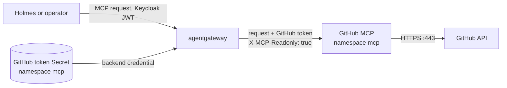
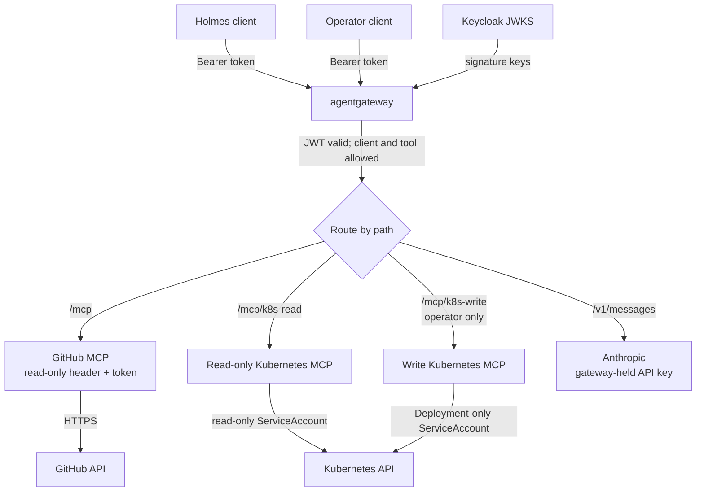

# Full lab setup

These commands build the local demonstration stack. They are written for macOS with Docker Desktop and `kind`. The manifests are secret-free. Review [known validation gaps](validation-gaps.md) before using a production cluster.

## 1. Install local tools

```bash
brew install kind kubectl helm jq gettext openssl
```

Start Docker Desktop and allocate at least 10 GB memory for the full stack. Confirm access:

```bash
docker version
kind version
kubectl version --client
helm version
jq --version
envsubst --version
```

## 2. Clone the feature branch

```bash
git clone --single-branch --branch codex/kubernetes-sre-security-lab \
  https://github.com/fsclyde/kubernetes-sre-security-lab.git
cd kubernetes-sre-security-lab
```

## 3. Create the audited cluster and install Calico

The cluster disables kind's default CNI so Calico can enforce NetworkPolicies. Kubernetes 1.35 keeps the `MutatingAdmissionPolicy` feature gate off by default; the kind configuration enables it because Calico 3.33's native CRD manifest uses that API. Prepare the audit mount paths before creating the cluster.

```bash
mkdir -p .local/k8s-audit
cp kind/audit-policy.yaml .local/audit-policy.yaml
kind create cluster --config kind/cluster.yaml --wait 120s
kubectl config use-context kind-agent-security-lab
kubectl cluster-info
./scripts/install-calico.sh
```

Install Gateway API and the agentgateway control plane:

```bash
kubectl apply --server-side --force-conflicts \
  -f https://github.com/kubernetes-sigs/gateway-api/releases/download/v1.6.2/standard-install.yaml

helm upgrade --install agentgateway-crds \
  oci://cr.agentgateway.dev/charts/agentgateway-crds \
  --create-namespace --namespace agentgateway-system \
  --version v1.6.0 --wait --timeout 5m

helm upgrade --install agentgateway \
  oci://cr.agentgateway.dev/charts/agentgateway \
  --namespace agentgateway-system --version v1.6.0 \
  --wait --timeout 5m
```

Create the namespaces, base RBAC, and separate Kubernetes MCP servers:

```bash
kubectl apply -f manifests/networking/namespaces.yaml
kubectl create namespace demo --dry-run=client -o yaml | kubectl apply -f -
kubectl create namespace mcp --dry-run=client -o yaml | kubectl apply -f -
kubectl apply -f manifests/rbac/demo-roles.yaml

helm upgrade --install k8s-mcp-read \
  oci://ghcr.io/containers/charts/kubernetes-mcp-server \
  --version 0.1.0 --namespace mcp \
  --values manifests/mcp/read-values.yaml --wait --timeout 5m

helm upgrade --install k8s-mcp-write \
  oci://ghcr.io/containers/charts/kubernetes-mcp-server \
  --version 0.1.0 --namespace mcp \
  --values manifests/mcp/write-values.yaml --wait --timeout 5m

kubectl patch service k8s-mcp-read -n mcp --type=json \
  -p='[{"op":"add","path":"/spec/ports/0/appProtocol","value":"agentgateway.dev/mcp"}]'
kubectl patch service k8s-mcp-write -n mcp --type=json \
  -p='[{"op":"add","path":"/spec/ports/0/appProtocol","value":"agentgateway.dev/mcp"}]'
```

## 4. Create credentials and install Keycloak

Create a fine-grained GitHub token for the GitHub MCP server:

1. In GitHub, open **Settings → Developer settings → Fine-grained personal access tokens → Generate new token**.
2. Give the token a recognizable name, choose an expiration that fits your lab session, and set **Resource owner** to the owner of the repository.
3. Under **Repository access**, select **Only select repositories** and choose the repository containing the demo issue and source code (for this lab, `kubernetes-sre-security-lab`).
4. Under **Repository permissions**, set **Contents: Read-only** and **Issues: Read-only**. Leave every other permission at **No access**. GitHub automatically includes the required read-only Metadata permission.
5. Generate the token and copy it. GitHub shows the token only once.

Have an Anthropic API key ready as well. The bootstrap script prompts for both values and stores them in ignored `.local/` files with owner-only permissions. The gateway injects the GitHub token into GitHub MCP and sets its `X-MCP-Readonly` header; do not grant write permissions.

```bash
./scripts/bootstrap-secrets.sh
kubectl apply -f manifests/keycloak/keycloak.yaml
kubectl rollout status deployment/keycloak -n identity --timeout=5m
```

The Keycloak realm creates separate `holmes` and `operator` confidential clients and uses a 300-second access token lifetime. The GitHub token is stored as a Secret in `mcp`, where the GitHub MCP backend is defined. The Anthropic API key is stored in `agentgateway-system`.

## 5. Deploy the demo app and GitHub MCP

```bash
kubectl apply -f manifests/demo/app.yaml
kubectl apply -f manifests/github-mcp/deployment.yaml
kubectl rollout status deployment/demo-web -n demo --timeout=3m
kubectl rollout status deployment/github-mcp -n mcp --timeout=3m
```

The GitHub MCP container runs in HTTP mode and does not receive the token from Holmes. For each proxied GitHub MCP request, agentgateway adds the GitHub token and `X-MCP-Readonly: true` header before forwarding the request to the GitHub MCP server. The MCP server then uses that token to call GitHub's API.



The NetworkPolicy permits the GitHub MCP pod to make outbound TCP connections on port 443. Standard Kubernetes NetworkPolicy matches IP addresses and ports, not DNS names such as `api.github.com`; the `0.0.0.0/0` rule therefore allows HTTPS to any IPv4 address. It is intentionally limited to this pod and port, but is broader than a GitHub-only allowlist.

## 6. Apply the Gateway API routes and policies

```bash
kubectl apply -f manifests/agentgateway/routes.yaml
kubectl get gateway,httproute,agentgatewaybackend,agentgatewaypolicy -A
kubectl get pods -n agentgateway-system
```

The Gateway accepts only Keycloak JWTs. The GitHub MCP backend has a tool allowlist, and only the `operator` client can reach the write-capable Kubernetes MCP backend. The Anthropic credential remains with agentgateway. Port-forward for local inspection:

```bash
kubectl port-forward -n agentgateway-system svc/agentgateway-proxy 8080:80
```

Start a second port-forward for Keycloak in another terminal:

```bash
kubectl port-forward -n identity svc/keycloak 8081:8080
```

Keep both port-forwards running in separate terminals. The smoke-test script below obtains short-lived Holmes and operator tokens from Keycloak for you; you do not need to copy or decode tokens manually.

The Gateway routes are `/mcp` for GitHub MCP, `/mcp/k8s-read` and `/mcp/k8s-write` for the Kubernetes MCP servers, and `/v1/messages` for Anthropic.

After these routes and policies are applied, agent traffic follows this path:



The Gateway validates the Keycloak JWT before routing. Its policy allows the `holmes` and `operator` clients for investigation/read routes and restricts the write-capable MCP backend to the `operator` client. Kubernetes RBAC separately limits what each MCP server can do at the API.

## Quick smoke test

With both port-forwards from section 6 still running, run this from the repository root:

```bash
/bin/bash scripts/smoke-test.sh
```

The script obtains short-lived tokens and prints one brief `PASS` or `FAIL` line per check, including the HTTP status and a short denial reason where applicable. To print the full `curl -i` headers and response bodies for troubleshooting, run:

```bash
VERBOSE=1 /bin/bash scripts/smoke-test.sh
```

It checks successful reads and these expected denials:

| Identity | The test expects it to be unable to... | Enforced by |
| --- | --- | --- |
| Holmes | Create a GitHub issue; use the Kubernetes write backend; read a Secret or anything outside `demo`; modify Deployments; delete or exec into Pods | Gateway tool allowlist, read-only Kubernetes MCP, and its namespace-scoped ServiceAccount RBAC |
| Operator | Create a GitHub issue; read a Secret; delete or exec into Pods; modify Deployments outside `demo` | Gateway GitHub tool allowlist and Kubernetes MCP ServiceAccount RBAC |

The operator can read and update Deployments in `demo`; its Kubernetes ServiceAccount has no permissions on other namespaces or resource types. Holmes can read the allowed resources in `demo`, but has no write backend.

Denied MCP tool calls can have HTTP `200` with an MCP error in the response body, so the script checks the body as well as the status. Brief results identify `unknown resource` for Gateway denials and `forbidden` for Kubernetes RBAC denials. The test uses fake names for Kubernetes probes and sends no model request, so it makes no cluster changes and incurs no Anthropic API usage. Use the [lab runbook](lab-runbook.md) for the full security exercise and proof criteria.

## 7. Deploy HolmesGPT and the operator release

The repository contains separate values files so each Holmes release has its own namespace and identity boundary. The built-in Kubernetes, Bash, internet, and default integrations are disabled.

The `holmes` and `operator` namespaces enforce the Kubernetes Pod Security `restricted` standard at version 1.35. Their Helm values set UID/GID 10001, `runAsNonRoot`, `RuntimeDefault` seccomp, `allowPrivilegeEscalation: false`, and drop all Linux capabilities so the pods satisfy that policy.

```bash
helm repo add robusta https://robusta-charts.storage.googleapis.com
helm repo update

helm upgrade --install holmes robusta/holmes \
  --namespace holmes --create-namespace \
  --values manifests/holmes/values.yaml --wait --timeout 10m

helm upgrade --install operator robusta/holmes \
  --namespace operator --create-namespace \
  --values manifests/operator/values.yaml --wait --timeout 10m
```

The two releases provide separate HolmesGPT deployments for investigation and repair. Connect their MCP and model clients to the authenticated gateway endpoints. Automated Keycloak client-credentials refresh inside the Holmes chart is still an integration item; do not put a long-lived bearer token in a ConfigMap or values file. The operator should be activated by the learner only for the repair step.

If the namespaces already exist, apply the updated labels and confirm them before upgrading the releases:

```bash
kubectl apply -f manifests/networking/namespaces.yaml
kubectl get namespace holmes operator \
  -L pod-security.kubernetes.io/enforce,pod-security.kubernetes.io/enforce-version
```

Both values files set the Holmes container UID and GID to `10001` while keeping `runAsNonRoot` enabled. This is required because the image metadata reports root; without an explicit non-root UID, Kubernetes rejects container creation before Holmes starts.

## 8. Apply NetworkPolicies and verify RBAC

Apply default-deny and allow rules only after required components are running:

```bash
kubectl apply -f manifests/networking/policies.yaml
./scripts/check-rbac.sh
kubectl get networkpolicy -A
```

The `mcp` servers can reach the Kubernetes API, while Holmes and operator pods do not get direct Kubernetes API egress. Policies are enforced by Calico, not kind's default networking.

## 9. Optional runtime detection

Install Falco for runtime events:

```bash
helm repo add falcosecurity https://falcosecurity.github.io/charts
helm repo update
helm upgrade --install falco falcosecurity/falco \
  --namespace falco --create-namespace \
  --values manifests/falco/values.yaml --wait --timeout 10m
```

The Kubernetes API audit log is written to `.local/k8s-audit/audit.log`. The current Falco values install runtime detection but do not yet configure the Falco Kubernetes audit webhook plugin; correlate audit records from the file directly until that integration is completed.

Tetragon needs a Linux kernel with BTF/eBPF support. Docker Desktop runs kind inside a Linux VM; support depends on the kernel exposed by that VM. Check whether the kind node can see BTF:

```bash
./scripts/check-tetragon-kernel.sh
```

On native Linux, install with the upstream chart after confirming the node kernel prerequisites:

```bash
helm repo add cilium https://helm.cilium.io
helm repo update
helm upgrade --install tetragon cilium/tetragon \
  --namespace kube-system --wait --timeout 10m
```

On Docker Desktop, skip Tetragon if its DaemonSet cannot load eBPF programs. Use the Tetragon FAQ and kind instructions in the references before troubleshooting kernel support.

## 10. Inspect and clean up

```bash
kubectl get pods -A
kubectl get gateway,httproute,agentgatewaybackend,agentgatewaypolicy -A
jq -c 'select(.user.username | startswith("system:serviceaccount:mcp:")) | {user: .user.username, verb, objectRef, responseStatus}' \
  .local/k8s-audit/audit.log
kind delete cluster --name agent-security-lab
```

Deleting the cluster leaves the repository checkout and local audit/secret files in place. Remove `.local/` manually when you no longer need those artifacts.
